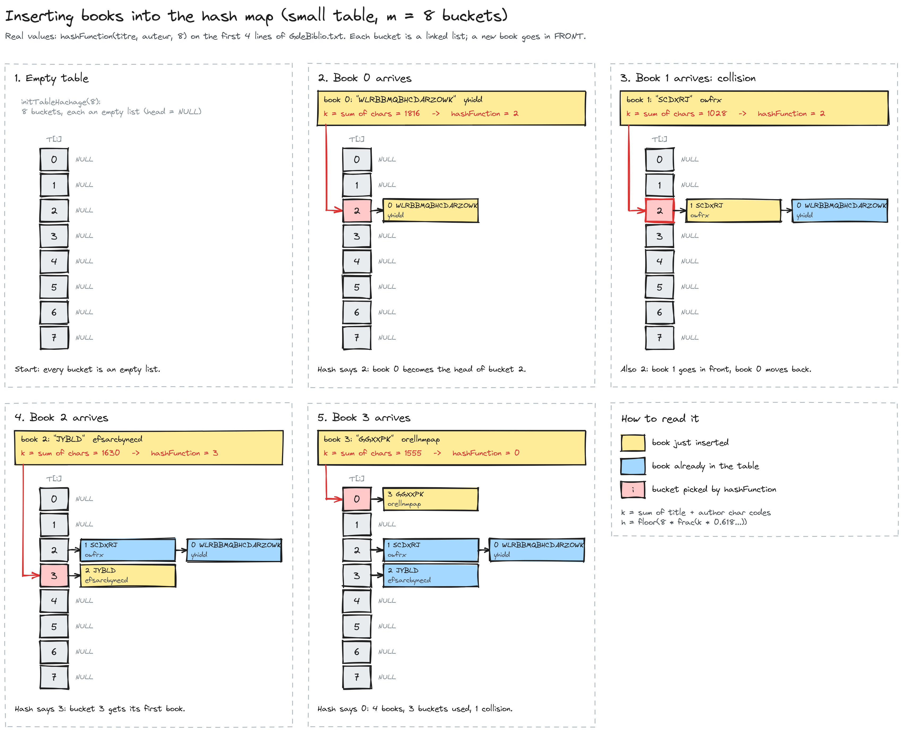
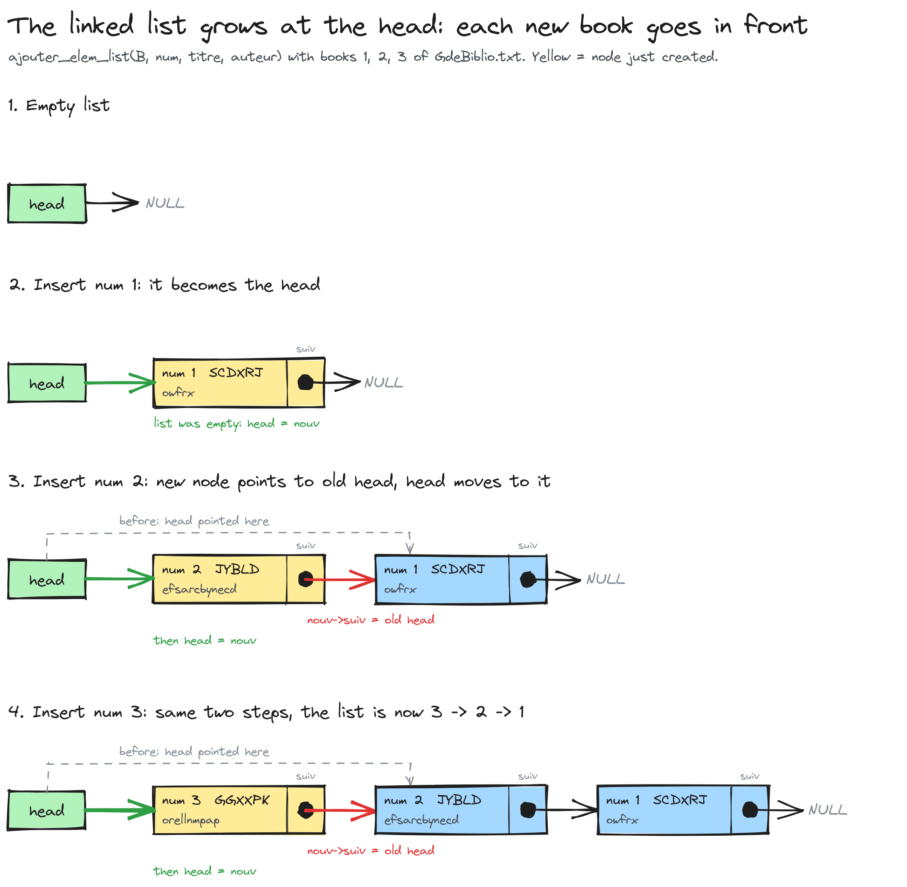

# MiniProjet-Algo

A C library catalogue. It loads book records from a text file into one of two data structures, a linked list or a hash map, and looks books up by number, title or author from a menu.



## What it does

Each record is a book: a number, a title and an author. The program reads the first *n* lines of a catalogue file and stores them in the structure you choose on the command line:

- **Linked list** (`1`): each new book is inserted at the head of the list, so the list shows the most recently read book first.
- **Hash map** (`2`): 1000 buckets. A hash of the title and author picks the bucket, and each bucket is a linked list where the new book goes at the front.



Both structures are built from the same record type (`s_livre`, `src/structs.h`) and the same reader (`lecture_n_entree_*`).

## Build and run

Requirements: a C compiler (`gcc` or `clang`) and `make`.

```sh
make                                  # builds ./MiniProjet
./MiniProjet GdeBiblio.txt 1 100      # linked list, first 100 records
./MiniProjet GdeBiblio.txt 2 100      # hash map, first 100 records
```

The three arguments are the catalogue file, the structure (`1` = linked list, `2` = hash map), and the number of records to read.

Other targets:

```sh
make test         # unit tests, then a smoke run of each backend
make test-asan    # the same tests under AddressSanitizer and UBSan
make clean
```

## Menu

| Option | Action |
|---|---|
| `1` | Read *n* records from the file into the structure |
| `2` | Show the list (or every bucket of the map) |
| `3` | Search by number. The key is fixed in `main.c` (`4`) |
| `4` | Search by title. The key is fixed in `main.c` (`"UKWAGM"`) |
| `5` | Search by author. The key is fixed in `main.c` (`"gspqoqm"`) |
| `0` | Quit |

Option `6` (insert a book) is listed in the menu but does nothing yet.

## Data file

One record per line: `number title author`. Titles and authors are single words of at most 29 characters.

`GdeBiblio.txt` is a sample catalogue of 100,000 records with randomly generated titles and authors.

## Project layout

```
src/
  main.c                 menu and program entry point
  structs.[ch]           book record and its constructor
  LinkedList_biblio.[ch] linked-list backend and reader
  Hashmap_biblio.[ch]    hash-map backend, hash function and reader
  entree_sortie.[ch]     word-by-word reading helpers
tests/test_biblio.c      unit tests (plain checks, no framework)
docs/assets/diagrams/    diagrams used in this README
Mini_Projet.pdf          the course assignment brief
GdeBiblio.txt            sample catalogue
```

## Status

- The hash map stores and counts books, but its search functions (`recherche_par_*`) are not implemented yet. In map mode, options `3` to `5` print nothing.
- The search keys in options `3` to `5` are fixed values in `main.c`, not typed by the user.
- Inserting a new book from the menu (option `6`) is not implemented.

## Tests

`make test` runs 36 checks. They cover:

- the book constructor copies its strings
- linked-list insertion (count and order), search by number, title and author, and the record limit of the reader
- the reader helpers (integers, a negative integer, a real number, a word)
- the hash function (always in range, same input gives the same output)
- hash-map insertion counts (map total and bucket total) and the map reader

`make test-asan` runs the same checks with AddressSanitizer and UBSan, which also report memory errors the checks cannot see.

## Continuous integration

`.github/workflows/build.yml` runs `make`, `make test` and `make test-asan` on every push and pull request.
